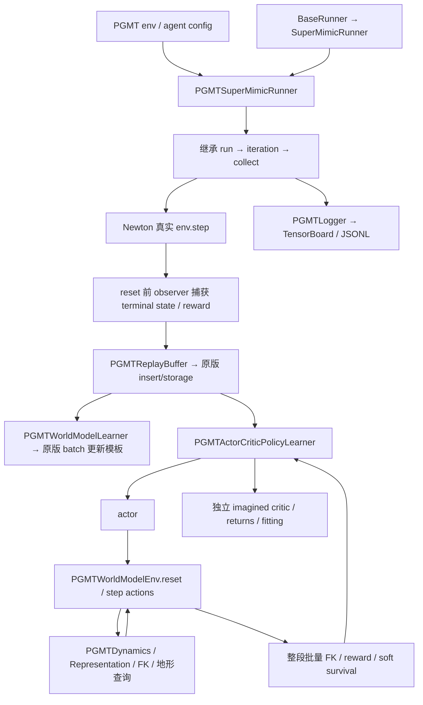

# SuperMimic 原版结构与 PGMT 扩展

## 目录

```text
pgmt/
├── config/g1/pgmt_supermimic_cfg.py   # 任务注册引用的环境/算法 recipe
├── models/                          # 现有 CNN / CrossAttention actor
├── mdp/、terrain_env.py、heightfield.py、foot_rewards.py、analytic_foot_rewards.py
└── supermimic/
    ├── runners/
    │   ├── supermimic_runner.py      # 复制 BaseRunner / SuperMimicRunner + 通用扩展钩子
    │   ├── pgmt_runner.py            # PGMT 组装、真实 transition、采集预算/课程
    │   └── pgmt_checkpoint.py        # 原子保存、恢复、旧权重导入、play 导出
    ├── envs/
    │   ├── world_model_env.py        # 共用 reset / step(actions) 模板
    │   ├── motion_tracking_env.py    # 原版参考动作环境
    │   └── pgmt_world_model_env.py   # PGMT 动力学、参考、support、history、reward
    ├── learners/                    # 唯一的 learners 目录
    │   ├── wm_learner.py、policy_learner.py、learner_utils.py
    │   └── pgmt_wm_learner.py、pgmt_policy_learner.py、pgmt_learner_utils.py
    ├── models.py / pgmt_models.py
    ├── representations.py / pgmt_representation.py
    ├── replay_buffer.py / pgmt_replay_buffer.py
    ├── sim_context.py / pgmt_sim_context.py
    ├── config.py、layouts.py         # 类型化参数、具名状态切片
    ├── utils/
    │   ├── logger.py / pgmt_logger.py
    │   ├── pgmt_mdp.py、pgmt_rewards.py、pgmt_terrain.py
    │   └── math.py、原版 FK/IK/辅助函数
    ├── tasks/、scripts/              # 保留复制的原版任务定义和 mjlab CLI
    └── LICENSE-SuperMimic、NOTICE、README.md
```

## 调用链



## 分工

| 模块 | 负责 | 不放入该模块的内容 |
|---|---|---|
| Runner | 组装组件、真实采集、阶段/预算、课程、调度、保存 | actor loss、WM loss、GAE 公式 |
| WorldModelEnv | 状态推进、参考/历史/地形 support 更新、奖励和软终止 | actor、critic、优化器、returns |
| PolicyLearner | actor 前向、想象 H 步、actor objective、critic bootstrap/returns/回归、EMA | Newton reset、真实传感器 |
| WorldModelLearner | 多步监督、contact BCE、terminal mask、normalizer、验证 | actor objective、真实课程 |
| Representation | 状态/预测布局、积分、表征、loss blocks | 采集和优化器 |
| ReplayBuffer | 原版存储/insert，PGMT 连续序列、terminal 与历史重建 | 参考动作生成和 reward |
| SimContext | 读取和表达固定物理上下文 | 训练流程 |
| Logger | 原统计口径、EpisodeReward 累积、分地形/TB/详细诊断 | 训练目标 |

## 实际复用的执行路径

`PGMTSuperMimicRunner` 没有重新实现 `run`、`iteration`、`collect` 或 `_step_and_store`。
这四个方法实际来自复制的 SM 基类。PGMT 覆盖工厂、每步 transition 数据、采集预算、
初始化/阶段、学习率、课程和日志钩子。原版 `run` 的采集/更新段被提取为这些共用方法，
在线日志和保存改为可覆盖的生命周期方法。

`PGMTWorldModelEnv` 继承 `MotionTrackingEnv → WorldModelEnv`，实际执行基类的
`reset` 和 `step(actions)`。PGMT 覆盖单步动力学、参考/历史更新、观测和 step extras。
为保留原来批量 FK 的性能，step 显式返回 `deferred_rewards=True` 和未结算的 reward；
PolicyLearner 完成 H 步后调用 `evaluate_trajectory()` 一次结算，不将假零奖励用于优化。

两个 PGMT learner 继承原版 `WorldModelLearner` / `ActorCriticPolicyLearner`。
WM batch 更新模板、actor 多 batch 汇总和 critic epoch/minibatch 回归来自共用基类；
任务 loss、终止 mask、外部 RNG、优化器分组、capture 状态等由 PGMT 方法提供。

`PGMTReplayBuffer` 的真实存储和写入调用原版 `ReplayBuffer.insert`；它扩展字段 shape、
terminal/truncation、环形连续窗口和紧凑历史重建。没有平行维护第二份 replay。

## 必须对齐的语义

- 原版工具采用 **WXYZ**；IsaacLab 原生状态为 **XYZW**。`utils/math.py` 对原版工具明确转换，
  PGMT 状态和现有 FK 保持 XYZW。不能只替换 import 后把同一四元数直接传入。
- PGMT 状态保持 71 维，速度输入保持现有 COM 语义；velocity 模型输出 35 维，
  由 representation 积分位姿。关节和身体映射来自既有配置。
- 真实状态在环境 reset **之前**捕获，终止 transition 保留；后继 episode 的历史不能拼入旧 episode。
- 原版 `terminated/truncated` 与 PGMT 的失败/超时有明确映射；想象路径保留原来的 soft survival、valid mask。
- 所有想象噪声/采样在图外准备；WM/critic 参数在 actor 更新中冻结，未来状态和地形查询梯度仍连接。
- 基座高度独立取基座正下方，不使用前移扫描网格的中心点。
- native `Episode_Reward` 依最大 episode 秒数统计；RealReward/ImaginedReward 是含 dt 的每步均值。
  日志重整没有修改奖励函数或归一化。

## 恢复和入口

训练继续使用 `scripts/instinct_rl/train.py`，task 为
`Instinct-PGMT-SuperMimic-G1-Newton-v0`；配置指向
`instinctlab.tasks.shadowing.pgmt.supermimic.runners.pgmt_runner:PGMTSuperMimicRunner`。

新 checkpoint 使用 `pgmt-supermimic-upstream-v2` schema，保存模型/EMA、优化器、normalizer、
课程、计数器、RNG 和有效参数。恢复时重置 CUDA Graph、清空 replay 并重新采集；
不声称逐 bit 续接旧物理轨迹。旧格式显式走权重初始化，不伪装成完整 resume。
兼容现有 play 的 `model_state_dict` actor 导出字段保留。

## 退役代码

审核树中移除旧 Desktop/Contact/Glimpse/Scan187/BPTT/辅助 WM Runner 和其专用注册、
重复 learner 与旧 WM 网页导出工具。原工程与 Git 历史保留它们；数值验证通过
`PGMT_LEGACY_SOURCE` 显式引用仓库外快照，不把旧 backend 带回运行时。

基线入口见 [REVIEW.md](REVIEW.md)，验证步骤见 [SM_VALIDATION.md](SM_VALIDATION.md)。
实验结果与运行状态记录在仓库外的 `InstinctLab-local/`。
