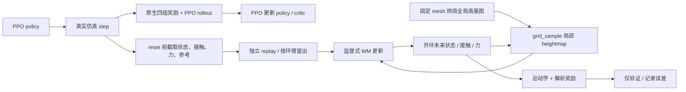

# 方案 A：PPO + 监督式 WM 诊断

## 范围与入口

本实现迁移旧 `feat/supermimic-heightmap` 中的局部状态增量、固定地形栅格采样、接触/接触力监督以及 URDF 运动学。没有迁移 imagined actor、独立 imagined critic、teacher、actor optimizer 或 BPTT policy 更新。

新增 task：`Instinct-PGMT-TerrainWMValidation-G1-Newton-v0`。
继承当前 `TerrainPPOValidation` 环境，保留 `dance1_subject2`、完整 L0–L9 几何、最高等级通过后随机分级的课程，以及 Newton `njmax=1024`。
原有 PPO task 的配置和 runner 不变。



启动可使用标准 `scripts/instinct_rl/train.py`，agent 参数见
`config/g1/agents/instinct_rl_wm_cfg.py`：

```bash
python scripts/instinct_rl/train.py \
  --task Instinct-PGMT-TerrainWMValidation-G1-Newton-v0 \
  --num_envs 4096 --max_iterations 2000 --run_name ppo_wm \
  agent.warm_start=/absolute/path/to/stage1/model_2700.pt
```

示例只说明入口，不代表本次启动了新的长程训练。开发机需使用已验证的解释器、环境变量与数据挂载；多卡沿用 torchrun，每张卡的 `--num_envs` 为局部环境数。

两种初始化只能选一种：

- `agent.warm_start=...`：沿用现有 stage1 actor/normalizer 扩展和新 critic 逻辑。
- `agent.ppo_checkpoint=...`：从当前 terrain PPO 载入 actor、critic、normalizer、源学习率和已有 terrain gate。PPO optimizer、WM、课程统计、仿真 episode 重新开始；不会把 4096×4 的训练伪装成不同规模的精确 resume。

真正的监督式 WM checkpoint resume 使用已有标准 resume 入口，恢复 PPO、WM 及 optimizer、rank 采样 RNG。仿真 episode/replay 重新填充；不是逐物理步复现。地形栅格摘要、奖励契约和 WM 参数改变会拒绝 resume。摘要按 rank 保存，因为不同 rank 可以生成不同随机地形；任一 rank 的契约不匹配时，所有 rank 一起退出，避免一部分进入恢复 collective 后挂起。当前 schema 为 `pgmt-supervised-wm-v3`。

## WM 状态、输入和输出

`wm_dynamics.py`：

| 项目 | 实现 |
|---|---|
| 完整状态 71 维 | pelvis link 位置 3、XYZW 四元数 4、世界系 COM 线速度 3、世界系角速度 3、29 关节位置、29 关节速度 |
| 状态特征 68 维 | 中心地形净空 1、机体系重力 3、机体系线速度 3、机体系角速度 3、q29、qd29；去除绝对 XY/yaw |
| 额外输入 | 当前实际施加动作 29、上一步动作 29、14 部位接触、真实 solver friction binding、随机 actuator 零点、torso COM 偏移 |
| 感知输入 | yaw 对齐 21×21、2m×2m 局部高程图；441→128→64 的 SiLU 编码器 |
| 主干 | 默认 3 层 512 宽 Linear/LayerNorm/SiLU；CUDA 主干可用 BF16，状态积分与误差保持 FP32 |
| 状态输出 70 维 | yaw 系位移 3、旋转向量 3、当前 root 系速度/角速度增量各 3、dq29、dqd29 |
| 辅助输出 | 14 接触 logits；14×3 合力，使用下一状态 root 系坐标 |

旋转采用 SO(3) 增量乘法并归一化四元数；零旋转处避免无效除法。COM 线速度与 link-origin 位置不同，运动学先减去 `ω × root_com_offset`，再递推 link 速度并补回各 link COM 偏移，匹配原生 body 速度含义。

随机参数只接受 startup 固定模式。若以后把 friction/零点/COM 改为每次 reset 随机，需要改为逐 transition 保存参数，当前实现会明确拒绝旧快照假设。

## 高程图

`heightfield.py` 将已知 mesh 按默认 0.05m 分辨率烘焙成一个全局 `[y,x]` 高度栅格。后续用 `grid_sample(align_corners=True)` 对预测 XY/yaw 双线性采样，再减去预测 root Z，截断至原生 `[-5,5]` 米。局部点序与原生 scanner 一致：X 为慢索引。

梯度可通过采样坐标传到预测位置/姿态，栅格自身固定；没有复制 batch 份全地形图。烘焙射线 miss 会报错；越出烘焙范围的预测会在序列有效掩码中屏蔽。

双线性栅格在台阶边缘会平滑高度跳变，有限差分法线也不等于 mesh 法线。因此分别记录真实 pose 下 raster 对 mesh 的误差，以及预测 pose 导致的局部图误差，不把二者混为一项。

## 监督训练和隔离

默认每次 PPO 的 24 步 rollout 后执行 8 次 WM AdamW 更新，学习率 `3e-4`，每 rank batch 512，训练开环长度 8（160ms）；按时间保留最近 48 步（2 个 PPO rollout）。增大卡数时总 WM batch 随 rank 数增加，梯度取平均；这些默认值是诊断起点，不是原论文超参复现。

每步在 reward 计算后、自动 reset 前截取真实 successor。终止 transition 本身可训练；其后的新 episode 不属于同一条开环序列。采样可跨越相邻 PPO rollout，连续 ring buffer 保留真实时间顺序；只有 episode 边界后被屏蔽。WM 所有训练数据 detach 并从 inference tensor 复制成可用于 autograd 的普通 tensor。

局部 `env_id % 8 == 0` 的完整环境留出，不参与 WM 梯度和 WM 归一化统计；其余 7/8 环境用于训练。PPO 仍使用所有环境。这是同 motion、不同环境/随机化/出生样本的 holdout，**不是新 motion 泛化验证**。

目标为开环状态误差的归一化 MSE，加 `0.1×contact BCE` 和 `0.1×归一化 force MSE`。状态误差使用 ground-truth 朝向定义坐标。尺度取在线标准差与物理误差下限之大者，避免近静止维度除以极小数。在线 moments 仅统计新收集的训练环境，不重复统计 replay 更新；多卡聚合统计和梯度。

训练 8 步时，第 2 步起使用 WM 的状态、接触概率与预测 pose 裁图，动作使用记录的真实动作。这是 WM 自身的序列监督反传，不是对 policy 做 BPTT。

WM 拥有独立参数、optimizer 和采样 Generator；初始化保护全局 RNG。PPO 更新先执行，WM 更新随后执行。WM 不消费 actor 输出的计算图，不向 actor/critic/观测 normalizer 写入参数或梯度。WM checkpoint 不改动部署 actor 接口。

## 解析奖励

`wm_rewards.py` 从当前环境实际启用的 term 配置读取权重/std，覆盖全部 27 项，按原生 `weight × control_dt` 得到逐控制步奖励：

- 上/下半身各 6 项：body position/orientation/linear/angular velocity、joint position/velocity。参考 XY/yaw 对齐当前待评估状态；参考净空加支撑高度；下半身使用当前 level/family 与 `tolerance_alpha`。
- auxiliary 9 项：root orientation、纠偏后的平面 root velocity、floating anchor、root vertical acceleration、端点 acceleration、action rate、soft joint limits、undesired contact、impact。
- terrain 6 项：touchdown 地形质量、reference contact match、切向 foot slip、force 方向判定 stumble、unexpected contact switch、force 平方。

支撑高度使用参考接触标签选取预测脚下地形高度，飞行时用 root 下方高度，并沿用原生一阶滤波。加速度使用相邻状态的 COM 速度与相邻参考速度；reset 后第一步的导数和 touchdown/switch 被屏蔽。

接触和力分别由 WM head 监督。诊断奖励将接触概率以 0.5 阈值变成接触状态，再与前一步接触生成 touchdown/switch；impact/stumble/force 不再像旧 pure-WM actor 目标那样省略。没有添加 reward prediction head。

**离散接触事件、stumble 阈值不提供平滑梯度。** 这里优先复现原生公式，尚未把它们作为 policy 目标。未来启用 BPTT 需要独立决定软事件/力门控及其梯度语义；本次不声称“全部原生奖励已可微”。

## 三层误差与验证

每 25 轮默认记录固定 holdout 与当前 holdout，开环 H=1/4/8/16/32（20/80/160/320/640ms）：

1. 状态预测：位置、旋转、线/角速度、q/qd 的物理单位 RMSE；与静止及恒速/恒关节速度外推基线比较。接触除 accuracy 外还报告 feet F1/Brier，避免大量不接触部位造成虚高；报告力 RMSE。
2. `oracle`：真实 successor、真实接触/力、真实 support + 原生 mesh 查询，经过运动学和解析公式，对照原生逐项奖励。检验状态/速度坐标、时序、权重、dt、公式。
3. `raster`：仍用真实状态/接触/力/support，但法线和地形质量来自栅格，隔离栅格近似；`predicted` 使用 WM 开环状态/接触/力与递推 support，检验完整奖励预测误差。

奖励比较使用记录的已知参考帧与真实动作序列，不需要 actor imagined rollout 或从未来真实状态构造 WM 输入；参考帧属于 motion-tracking 已知条件。当前验证不评价改变动作后的反事实动力学梯度。

`wm-contract.json` 保存契约，`wm-metrics.jsonl` 保存逐项绝对误差。不要仅看总奖励误差，因为不同项可能互相抵消。checkpoint 中新增 `supervised_wm`，原生 PPO 参数结构保留。

有界验收脚本：`scripts/pgmt/validate_supervised_wm.py`。先执行真实 PPO+WM，再固定 replay 训练 WM，检查 policy/normalizer/global RNG 完全不变、留出分组、reset 掩码、heightmap 坐标梯度、checkpoint/optimizer 完全重载及多卡 WM 一致。诊断主动覆盖全部 10 个难度，训练 task 的初始课程等级仍为 L0。

本次实测结果、源码 SHA、使用的 PPO checkpoint 和运行位置保存在仓库外 `InstinctLab-local/ppo-wm-diagnostics-20261101/`；以该目录的最终报告为准。短程监督收敛不等于 tracker 已达到 stage2，也不证明 WM 的动作梯度可用于 policy 优化。

## 本次自主决策

1. 新增独立 task/runner，避免改变现有纯 PPO 的训练或 checkpoint。
2. 使用修正后的 Scheme A 状态/force/COM 运动学，而非复制旧 BPTT runner 和遗漏奖励。
3. 保持 512 宽、8 步监督、有限 replay 的低成本诊断默认值；全部通过 agent 字典调整。
4. 支持学习中的 PPO checkpoint 初始化，保留已训练 terrain gate；与 stage1 warm-start 明确区分。
5. 严格分离公式、栅格和预测误差；保留原生硬事件，暂不引入软奖励设计影响 PPO。
6. 固定留出完整环境，并用独立 RNG；验证分数不能通过重复采样相邻训练窗口或归一化泄漏虚高。
7. 先做有界单卡和多卡正确性验证；不自动启动另一项长程训练占用正在使用的四卡。

### 验证口径补充

奖励目标是仿真的原生即时奖励，不包含 PPO 在 timeout 时添加的 value bootstrap。接触分类与力回归是两个独立监督 head，目前没有强制二者物理一致；逐项奖励误差用于暴露这一限制。归一化 moments 沿用方案 A 的 `2e8` 样本上限，达到上限后固定统计量。

对照中的“baseline”指真实 PPO 收集结束、离线固定 replay 训练开始前的 WM，不是完全未训练的网络。固定 holdout 用于比较离线训练前后；当前 holdout 每次重新采样，二者都需结合 `valid_fraction` 解释。8 步未跨 episode 的窗口得分，不代表所有失败 episode 都能预测 8 步。


## 三组正式对照（2026-11-01）

PPO 仍为 24 步/轮；WM 训练统一 H8，验证统一 H1/4/8/16/32。H32 超出一次 PPO rollout，因此使用容量 48 步的连续环形 replay。第一次 24 步不足 H32 时不记录虚假的验证分数；第二轮后首次验证，随后每 25 轮验证。一次 H32 前向复用其所有前缀，并复用预测 support 序列，避免为每个视距重复 rollout。

| 组别 | predict_contact | predict_force | dynamics contact 输入 | 可预测奖励项 |
|---|---|---|---|---|
| full | true | true | 真实起点 + 后续预测接触 | 27 |
| no_contact_force | false | false | 删除输入通道 | 19 |
| no_force | true | false | 真实起点 + 后续预测接触 | 24 |

命令覆盖键为 `agent.world_model.predict_contact=false` / `agent.world_model.predict_force=false`。关闭的 head、归一化统计和监督 loss 都不存在；不会用零 loss 留着完整 head，也不会在后续 WM 步中偷偷使用真实 contact/force。力预测目前要求同时启用接触预测。

**三组 PPO 全部保留相同的 27 项原生奖励**，包括 impact/stumble/force。此处验证的是辅助 WM 头消融，不是改变 PPO 目标。真实 contact/force 仍保存在 replay 中用于独立 oracle 验证，关闭的目标不进入 WM 的输入、loss 或归一化统计。

无 force 时，预测奖励不支持 `auxiliary/impact`、`terrain/stumble`、`terrain/force`。无 contact/force 时，还不支持 `auxiliary/undesired_contact`、`terrain/slip`、`terrain/match`、`terrain/switch`、`terrain/touchdown`。缺失的项不会填零并冒充完整奖励。

所有组记录 `reward_common_mae`（相同 19 项）用于公平比较；另记录 `reward_supported_mae`（各组各自支持的 27/19/24 项），以及完整 27 项真实状态 oracle/raster 误差。仅 full 保留完整 `reward_predicted_mae`。不支持的 contact/force 指标不输出，具体可预测项写入 `wm-contract.json`。

三组正式配置固定：原 stage1 `model_2700.pt` 初始化、WM 从零开始、同 seed42、每组 4 GPU×4096 环境、2000 PPO 轮。head 消融不会引入 WM/BPTT policy 更新，因此重点比较 WM 状态/奖励预测、速度与显存；policy 效果仍由相同 PPO 目标决定。

运行时记录非验证轮和验证轮耗时，分别报告均值/中位数/P95；同时记录四个 rank 及每秒 NVML 利用率、显存。资源不足时保留每组四卡，等待现有训练释放，再串行运行；profile 独立初始化且不向正式训练传递权重、optimizer 或更新计数。运行清单和证据位于仓库外 `InstinctLab-local/ppo-wm-ablation-20261101/`。

训练 loss、更新计数与 WM 用时每轮记录；数百个验证指标仅在实际验证轮写入 PPO 日志，完整逐项指标仍保存在 `wm-metrics.jsonl`。这样不会每个普通轮重复聚合过期分数，也不会让缓存的验证计数覆盖当前 WM 更新计数。
